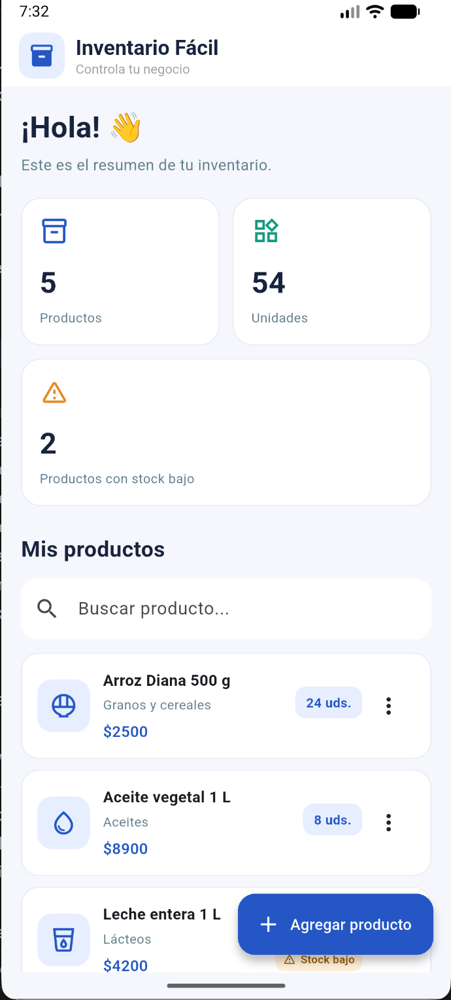
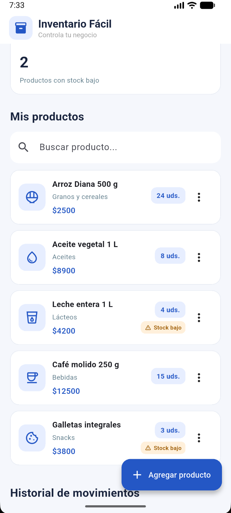
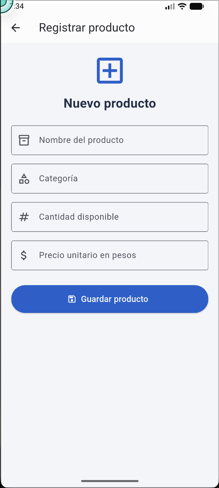
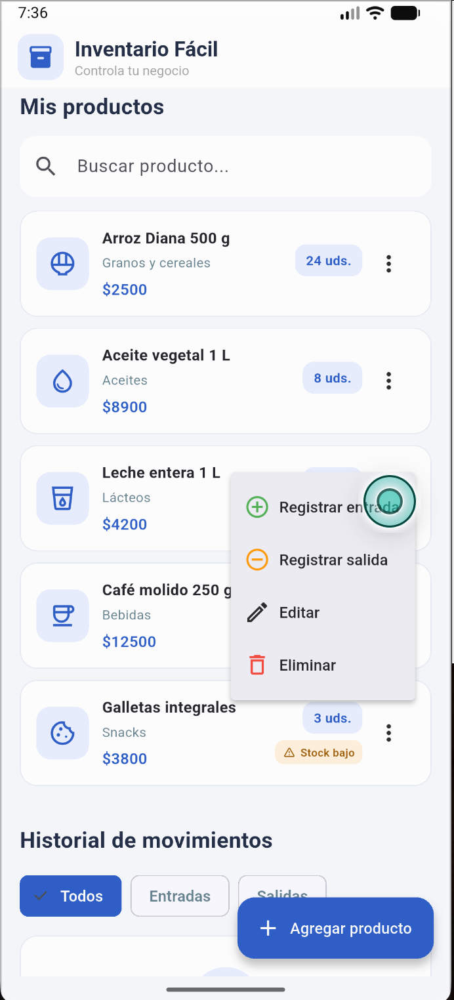
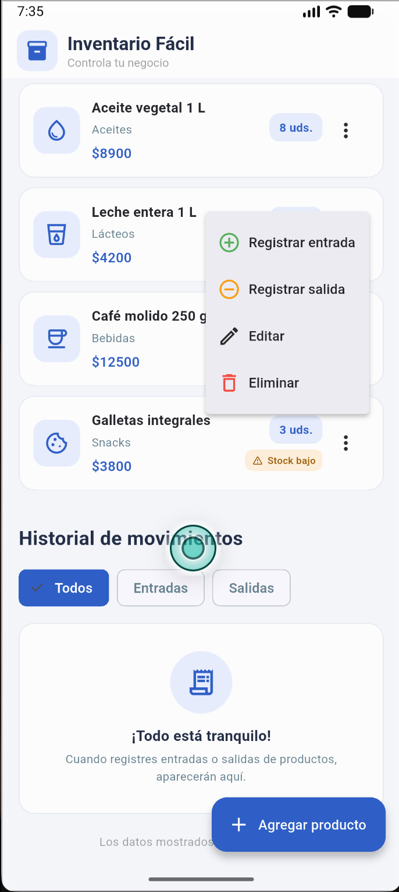

# 📦 Inventario Fácil

**Aplicación móvil para la gestión y el control de inventarios.**

## 1. Descripción del proyecto

Inventario Fácil es una aplicación móvil desarrollada con Flutter y Dart, orientada a facilitar la administración y el control de inventarios en pequeños negocios y emprendimientos.

La aplicación permite registrar productos, consultar existencias, actualizar información y controlar los movimientos de entrada y salida de mercancía. Su propósito es ofrecer una herramienta sencilla, organizada y accesible que contribuya a mejorar el seguimiento de los productos y reducir errores en el manejo de inventarios.

Este proyecto se desarrolla en el marco del curso **Diseño de Aplicaciones Móviles** de la Universidad Católica del Norte (UCN), mediante la metodología de Aprendizaje Basado en Proyectos (ABP).

## 2. Planteamiento del problema

Muchos pequeños negocios realizan el control de sus inventarios mediante registros manuales, hojas de cálculo o procedimientos poco estructurados. Estas prácticas pueden generar dificultades para conocer las cantidades disponibles, identificar movimientos de mercancía y mantener actualizada la información de los productos.

Ante esta situación, surge la necesidad de desarrollar una solución tecnológica que permita gestionar los inventarios de manera organizada, facilitando el registro, la consulta y el seguimiento de los productos.

## 3. Objetivos

### Objetivo general

Desarrollar una aplicación móvil para la gestión y el control de inventarios, que facilite el registro de productos, la actualización de existencias y el seguimiento de los movimientos de mercancía.

### Objetivos específicos

- Diseñar una interfaz intuitiva y fácil de utilizar.
- Implementar funcionalidades para registrar, editar y consultar productos.
- Controlar las cantidades disponibles mediante movimientos de entrada y salida.
- Incorporar validaciones para evitar inconsistencias en las existencias.
- Implementar mecanismos de persistencia de información.
- Diseñar una arquitectura tecnológica que permita proyectar la solución hacia servicios en la nube.

## 4. Justificación

La gestión adecuada de inventarios es fundamental para el funcionamiento de cualquier negocio que comercialice productos. Contar con información organizada permite mejorar el control de existencias, facilitar la toma de decisiones y reducir posibles pérdidas ocasionadas por errores en los registros.

Inventario Fácil busca responder a esta necesidad mediante una aplicación móvil que centraliza las operaciones básicas de inventario en una interfaz sencilla y funcional.

## 5. Tecnologías utilizadas

| Tecnología | Aplicación en el proyecto |
|---|---|
| Flutter | Framework para el desarrollo de la aplicación móvil. |
| Dart | Lenguaje de programación. |
| Visual Studio Code | Entorno de desarrollo. |
| Shared Preferences | Persistencia local de información. |
| Git | Control de versiones. |
| GitHub | Alojamiento y gestión del código fuente. |

## 6. Funcionalidades principales

### Gestión de productos
- Registrar nuevos productos.
- Editar la información de los productos.
- Consultar los productos registrados.
- Administrar nombre, categoría, cantidad y precio.

### Control de inventario
- Consultar el total de productos registrados.
- Visualizar las unidades disponibles.
- Identificar productos con existencias bajas.
- Mantener actualizadas las cantidades disponibles.

### Movimientos de inventario
- Registrar entradas de mercancía.
- Registrar salidas de mercancía.
- Validar que las salidas no superen las existencias disponibles.
- Consultar el historial de movimientos realizados.

### Persistencia de información
- Guardar la información de los productos.
- Conservar los registros de movimientos.
- Recuperar la información almacenada al iniciar nuevamente la aplicación.

## 7. Arquitectura tecnológica

La aplicación está desarrollada utilizando Flutter y Dart, con una estructura basada en componentes que permiten separar la interfaz, la lógica de funcionamiento y el manejo de los datos.

Actualmente, la persistencia de información se realiza de manera local mediante Shared Preferences.

Como proyección de la arquitectura, se contempla la integración de servicios en la nube que permitan almacenar y consultar la información de inventario de forma remota.

**Nota:** La integración de almacenamiento en la nube se documentará como implementada únicamente cuando se encuentre desarrollada y probada.

inventario_facil/
│
├── android/                 # Configuración para Android
├── ios/                     # Configuración para iOS
├── lib/
│   └── main.dart            # Código principal de la aplicación
│
├── test/                    # Pruebas del proyecto
│   └── widget_test.dart
│
├── docs/
│   ├── arquitectura/        # Documentación de arquitectura
│   ├── evidencias/          # Capturas de funcionamiento
│   └── presentacion/        # Material de presentación
│
├── web/                     # Configuración para web
├── windows/                 # Configuración para Windows
├── linux/                   # Configuración para Linux
├── macos/                   # Configuración para macOS
│
├── pubspec.yaml             # Dependencias y configuración
├── pubspec.lock             # Versiones de dependencias
├── analysis_options.yaml    # Reglas de análisis
├── .gitignore               # Archivos excluidos de Git
└── README.md                # Documentación principal

## 9. Requisitos de instalación

Para ejecutar el proyecto se requiere:

- Flutter SDK.
- Dart SDK.
- Visual Studio Code.
- Android Studio o un dispositivo Android configurado.
- Git.

### Pasos para ejecutar el proyecto

1. Clonar el repositorio:

```bash
git clone URL_DEL_REPOSITORIO
```

2. Ingresar a la carpeta:

```bash
cd inventario_facil
```

3. Instalar las dependencias:

```bash
flutter pub get
```

4. Ejecutar la aplicación:

```bash
flutter run
```

## 10. Evidencias del proyecto

A continuación, se presentan capturas de pantalla que muestran las principales funcionalidades de Inventario Fácil.

### 10.1 Pantalla principal


### 10.2 Lista de productos


### 10.3 Formulario de productos


### 10.4 Movimientos de inventario


### 10.5 Historial de movimientos


## 11. Alcance del proyecto

La primera versión de Inventario Fácil contempla las funcionalidades esenciales para la administración de productos y el control de movimientos de inventario.

El proyecto podrá evolucionar mediante la incorporación de servicios de almacenamiento en la nube, autenticación de usuarios, sincronización de información y generación de reportes.

## 12. Información académica

**Proyecto:** Inventario Fácil  
**Curso:** Diseño de Aplicaciones Móviles  
**Institución:** Universidad Católica del Norte (UCN)  
**Modalidad:** Aprendizaje Basado en Proyectos (ABP)  
**Tecnologías principales:** Flutter y Dart

---

**Inventario Fácil – Una solución tecnológica para una gestión de inventarios más organizada y eficiente.**